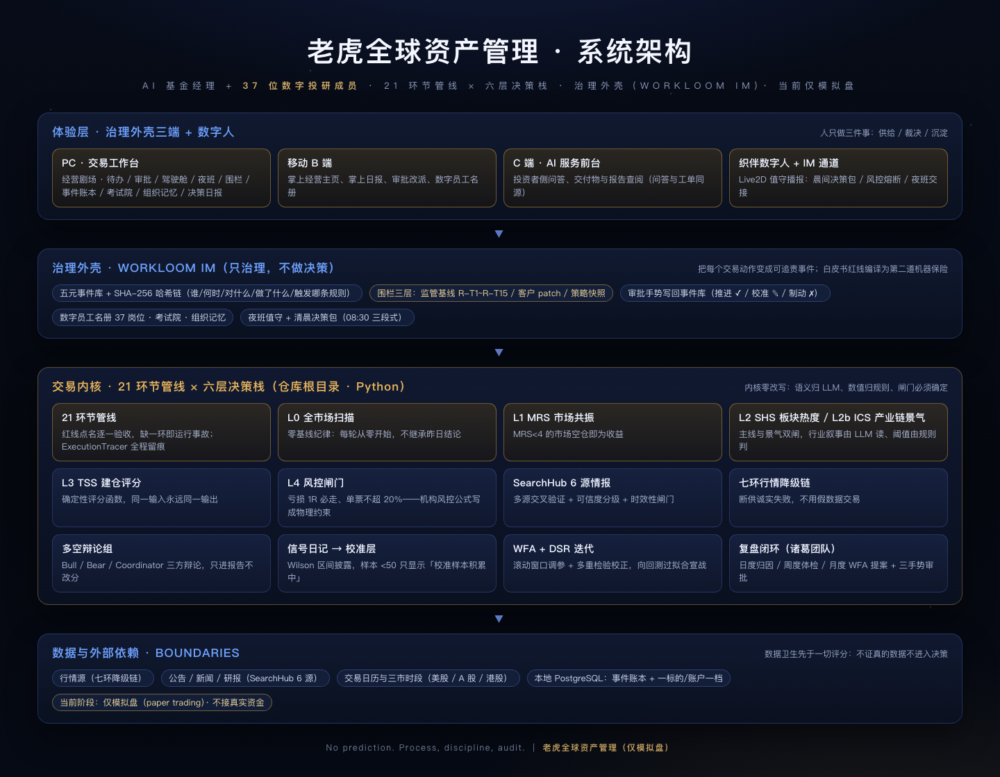
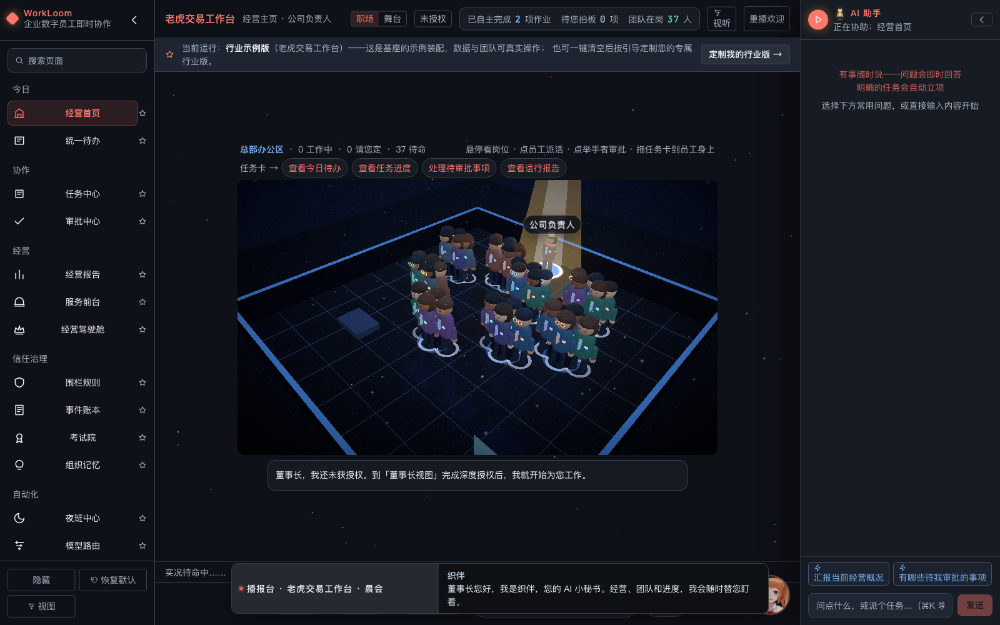

# Tiger · 老虎全球资产管理

Tiger 是一个面向多市场投研的**模拟资产管理系统**。它把行情、公开情报、候选筛选、风险检查和模拟账户记录串成一条可复核的研究流程。运行报告能回答三个问题：系统用了哪些资料、为什么给出某项纸面判断、哪些条件让判断停在观察阶段。

[English](README_EN.md) · [系统怎么工作](#系统怎么工作) · [示例界面](#示例界面) · [快速开始](#快速开始交易内核) · [Agent 操作指南](docs/TIGER-OPERATOR.md)

## 系统怎么工作

1. **筛选并固定候选。** Python 内核按市场、流动性和历史数据筛选标的。受控公开美股研究采用 `us-public-intelligence-paper-v2`，从高流动性扫描池产生独立数值候选。
2. **收集并核验资料。** 系统按研究问题获取登记来源的原文和附件，核对实体、时间与用途。资料不足时，记录缺口。
3. **形成纸面判断。** 模型整理舆情、行业叙事和多空论点，代码执行数值与风险检查。候选可以通过、等待或被排除。
4. **留下可核验回执。** 报告、来源、流程状态和模拟账户变更可以与同一运行记录对照。WorkLoom 治理界面提供审批、围栏和事件账本。



[数据与 Agent 管线图](docs/images/diagrams/data-pipeline.png) · [研究与证据采集](docs/INTELLIGENCE-ACQUISITION.md) · [治理设计](docs/GOVERNANCE.md)

## 示例界面

以下为仓库已有的模拟运行截图。工作台用于查看投研班组、待办和审批，事件账本用于追溯动作和触发规则。



[决策日报](docs/images/shots/pc-reports.png) · [事件账本](docs/images/shots/pc-events.png) · [模拟盘验证约定](docs/PUBLIC_VERIFICATION.md)

## 从哪里开始

| 你的目标 | 入口 |
| --- | --- |
| 看一遍离线演示 | [快速开始](#快速开始交易内核) |
| 用 Codex 或 Qoder 操作受控后端 | [Tiger 对话操作指南](docs/TIGER-OPERATOR.md) |
| 看研究、风险和评分的实现 | [Python 内核](trading_system/) · [决策与风险配置](trading_system/config.py) |
| 看审批、角色与事件账本 | [WorkLoom 治理壳](governance/README.md) · [资管行业包](governance/bundles/trading/) |

更多设计背景、流程细节与界面见[原版项目介绍](https://github.com/geniusdapeng-collab/workroom-tiger/blob/68c312e394a109f41340d948f37e10feb2a64d74/README.md)。本项目仅用于技术研究和模拟验证。

---

<!-- WORKLOOM-AUTONOMOUS-OPERATIONS:BEGIN -->
## 🧭 理论纲领 · AI 自主经营模式

> **客户购买的不是工具，而是一家正在运行的公司。**
> 本仓是 WorkLoom「AI 自主经营」体系的一部分；完整纲领《AI 自主经营纲领——论一个新经营范式的诞生》见 **[AI-AUTONOMOUS-OPERATIONS.md](AI-AUTONOMOUS-OPERATIONS.md)**。

- **成本结构翻转**：人类公司的管理动作，是为"人不可靠"支付的三种对冲税（激励 / 层级 / 监督）；AI 自治退掉这笔税，转而为 **边界定义 + 持续评测** 付费。
- **三个翻转**：管理对象从动机 → **边界**；经营动作从传递信息 → **分配注意力**；行业 knowhow 从"人在经验在" → **可计量资产**。
- **责任不可自动化**：AI 不能坐牢、不能赔钱。围栏 / 人审 / 汇报 / 事件账本构成的治理层，是自治的**对价**，不是限制器。
- **终态判据**：没有客户操作，这件事还会不会发生？"开箱即用"不够——终态是 **没开箱就在运营**：首次登录看到的是已经跑出来的业务进展与第一份汇报。
- **自治权是挣来的**：观察 → 请示后执行 → 汇报后执行 → 全权自治，按决策域用回测证据升降档；汇报透明是自治的价格标签。
- **度量即货币**：自治率、客户干预率、回测命中率三条曲线决定自治权扩张；模拟成功不计入自治率。
<!-- WORKLOOM-AUTONOMOUS-OPERATIONS:END -->

## 快速开始（交易内核）

只通过 Codex、Qoder 等平台对话操作后端时，从 [对话操作指南](docs/TIGER-OPERATOR.md) 开始。
Agent 会先检查环境，再按固定 CLI/MCP 提交与查询同一个任务，取得独立核验回执后汇报。
平台配置、Qoder CLI 与桌面导入的区别见 [客户端接入指南](docs/AGENT-CLIENTS.md)；
同一 profile 的纸面账户保持同一 state-root，日常新任务只更换逻辑幂等键。

```bash
bash scripts/setup.sh                # 一键安装+自检（或 pip install -r requirements.txt）
python3 -m pytest tests/ -q          # 交易内核测试（本机实测 327 passed，2026-09-19）
python3 main.py --demo               # 离线演示（合成数据，端到端 21 环节）
python3 main.py --universe focused --top 30 --picks 8 # 受控 v2 默认：120 只核心扫描
python3 main.py --universe full --top 30 --picks 8    # 旧通用入口的全市场实验
bash scripts/stack_setup.sh          # 全栈：+ WorkLoom 治理底座（Node≥24/Docker）

# S6 复盘闭环与审批流
python3 main.py --review-list                            # 查看 WFA 参数提案
python3 main.py --review-approve <id>                    # 批准 → 次日生效并披露
python3 main.py --review-reject <id> --reason "..."      # 驳回（原因必填）
```

普通非受控旧入口保留离线演示与透传语义，详见 [docs/QUICKSTART.md](docs/QUICKSTART.md)。新的 AI 研究和官网更新必须显式使用受控 CLI/MCP 和 `us-public-intelligence-paper-v2`，按 [Agent 操作指南](docs/AGENT-CLIENTS.md) 加载仓库外受保护环境文件；模板见 [`.env.example`](.env.example)。新配置先冻结独立数值候选，再按研究问题采集登记来源、原文与附件，逐目标验证实体、事件、时间和用途并冻结证据包。缺资料的目标保留 `null` 与缺口；搜索成功不会自动获得评分或行动资格。原 `us-public-model-required-paper-v1` 和更早 profile 保留历史回放。

受控 v2 默认用 `focused` 扫描池：120 只内嵌核心高流动性标的。它是稳定的广覆盖起点，
不是美股全量，也不等于最终研究范围；运行时仍按价格、20 日成交额、历史和波动率过滤，
再结合相对强度、均线、波动收缩和接近新高排序。产业链行情会单独并入用于板块与风险
上下文。需要对照广扫时可用 `extended`（480 只基础池，加链上补充标的后当前为 505 只），
需要完整证券目录时用 `full`（Nasdaq Trader 官方清单）。历史 profile 继续按其冻结源码和
合同读取，不能把今天的池子或结果回写到旧任务。

受控入口提供 `doctor / describe / run / resume / supplement / cancel / status / receipt / verify`。`resume` 只恢复同一 stopped run 的原身份、源码、策略、账户 before-state 与 deadline；`supplement` 从已核验 pending candidate 新建完整研究 admission，不复用旧证据快照或交易批准；`cancel` 只持久化调度取消请求，未知外部调用保持预留。`status` 的 `data.research_status` 分开显示流程、证据、决策和账户四轴，receipt/verify 仍必须独立通过。

文本语义仍固定 `deepseek-flash` + JSON mode，官方别名于 2026-10-26 观察为 `DeepSeek-V4.1-Flash-1017`，不宣称不可变快照。每次请求使用仓库内固定官方 tokenizer 对完整序列化输入计数，并申请全部合法剩余输出窗口；thinking 由场景策略决定：清洗/舆情非思考，风险/板块叙事 high，最终多空判断 max。工具请求/Fetch/字节/轮次/时限预算与模型窗口分别管理。可选 Brave、Tavily、Exa 仅用于发现资料，不替代文本模型；官方能力见 [Models & Pricing](https://api-docs.deepseek.com/quick_start/pricing/)、[Token 用量](https://api-docs.deepseek.com/zh-cn/quick_start/token_usage/) 和 [Search & Fetch](https://api-docs.deepseek.com/guides/search/)。五个模型阶段真实完整且独立校验通过才算完成；disabled、passthrough、规则语义替代或任何失败都不能交付为成功。该配置不启用 active 实验。网站的人读研究包含为什么关注、入场/失效条件、风险及来源；资金和数值为明确标识的模拟参考，富途/老虎真实操作由人执行，实际收益只来自真实成交回报。

独立来源同步/短时监测、原文证据查询和离线 100 题五类合同评测见 [情报采集指南](docs/INTELLIGENCE-ACQUISITION.md)。仓内评测是 synthetic_fixture，不代表真实供应商效果或生产 SLA。

### 治理外壳三端（模拟运行态）

```bash
cd governance
pnpm setup && pnpm preview:all
```

| 端 | 地址 | 说明 |
|---|---|---|
| PC 端 · 治理工作台 | http://localhost:3000 | 经营剧场（老虎交易工作台，默认工作区）/ 审批中心 / 夜班中心 / 董事长视图 |
| 移动端 · C 端 | http://localhost:3002 | 老虎交易 AI 服务前台 H5（查净值 / 数据服务 / 异常申报，演示直登） |

> 治理外壳默认进入 `tiger-trading` 老虎交易工作区；如需切换其他演示工作区，启动 web 时设置 `VITE_DEMO_WORKSPACE` / `VITE_DEMO_MEMBER` 覆盖。

### 从模拟运行态到真实数据

治理外壳种子完成后即进入**全模拟运行态**（演示数据 + 内置确定性模型，零外部依赖），页面顶部常显琥珀色横幅提示。点击「接入真实数据 →」进入**落地向导**（`/onboarding`）：① 环境自检（自动）→ ② 接入真实大模型（DeepSeek / Kimi / 智谱 / OpenAI 预设一键填，真实试调通过才落盘，保存即全链生效免重启）→ ③ 登记经营主体 → ④ 启用真实模式（横幅熄灭，全程五元事件留痕）。

---

## 面向 AI Coding Agent（治理外壳开发）

以下启动和页面验证要求用于 `governance/` 治理外壳开发。仅通过 CLI/MCP 操作 Tiger 后端时，按 [对话操作指南](docs/TIGER-OPERATOR.md) 执行，无需启动治理壳或官网。

治理外壳开发沿用 WorkLoom IM 底座约定：

1. 进仓先读 [`governance/README.md`](governance/README.md)；全量能力清单见 `governance/docs/capability-map.md`；
2. **首启必跑 `pnpm preview:all`**（governance 目录下），未完成视为环境初始化未完成；
3. **一键能力巡游 `pnpm agent:tour`**：环境 + 数据 + 服务 + 浏览器四层自检；
4. **操作电脑入口**位于 `governance/packages/base/computer-use/`，包含浏览器 DOM、GUI 语义树与截图感知；先运行 `pnpm computer:preflight && pnpm computer:smoke` 核对本机依赖、权限和执行结果。目录存在不能代替运行验收，HTTP / MCP 接入见 `governance/docs/computer-use-production.md`；
5. **验证纪律**：改完代码必跑 `pnpm suite`；发布前必跑 `pnpm release:gate`；改事件 / 号源后跑 `pnpm db:verify-chain`；UI 改动必须用浏览器能力实际打开页面截图核对。

---

## 文档地图

| 文档 | 说明 |
|---|---|
| [docs/CAISHEN_README.md](docs/CAISHEN_README.md) | 交易内核完整文档 |
| [reports/AI短线美股交易白皮书_20260730.pdf](reports/AI短线美股交易白皮书_20260730.pdf) | 交易理念白皮书（最高纪律） |
| [docs/GOVERNANCE.md](docs/GOVERNANCE.md) | WorkLoom 治理外壳接入设计 |
| [docs/PROJECT_INTRO.md](docs/PROJECT_INTRO.md) / [docs/PROJECT_INTRO_EN.md](docs/PROJECT_INTRO_EN.md) | 项目介绍（中文详细版 / English） |
| [README_EN.md](README_EN.md) | English README |
| [research/UPGRADE_PLAN_v3.md](research/UPGRADE_PLAN_v3.md) | 升级方案（已确认） |
| [research/01_benchmark.html](research/01_benchmark.html) | 调研一：行业标杆竞品深度调研（桥水 AIA 等 9 家） |
| [research/02_frontline.html](research/02_frontline.html) | 调研二：投资团队一线作业与 know-how 调研 |
| [docs/AGENT_CENSUS.md](docs/AGENT_CENSUS.md) | Agent 普查（20 个 Agent/模块分类） |
| [docs/DATA_HYGIENE.md](docs/DATA_HYGIENE.md) | 数据卫生纪律 |
| [docs/INTELLIGENCE-ACQUISITION.md](docs/INTELLIGENCE-ACQUISITION.md) | 受控来源采集、逐目标证据、冻结包、同步/监测及离线评测 |
| [docs/PUBLIC_VERIFICATION.md](docs/PUBLIC_VERIFICATION.md) | 模拟盘公开验证章程 |

## 质量与验证（本机实测 · 2026-09-19）

| 层 | 命令 | 结果 |
|---|---|---|
| 交易内核（Python） | `python3 -m pytest tests/ -q` | ✅ **327 passed** |
| 治理外壳（WorkLoom IM） | `cd governance && SUITE_SERVER_PORT=8899 pnpm suite` | ⚠️ **354/459 通过（105 失败）** |

治理外壳套件的失败高度集中在外键约束（`threads/night_runs/triggers_workspace_id_fkey`）与「基线规则装载 0 条」两类，根因是 `governance/scripts/suite.ts` 的 scope 仍硬编码基座酒店演示工作区 `ws-yunqi`，而本仓种子建的是交易工作区 `trading`（`governance/bundles/` 下也不再随仓携带 hotel 包）。**本次未修改测试逻辑**，如实登记为待修；修复方向是把 suite scope 参数化到 `product.manifest.json` 的演示工作区。

## 合规声明

本系统为技术研究与模拟验证项目：**仅模拟盘，不做真实下单**；不构成投资建议；免费行情源存在延时（已在报告中标注）。实盘交易需另行接入持牌券商并满足各市场监管要求（美股 SEC 15c3-5、A股程序化交易报备、港股 SFC）。

## 许可证

Apache-2.0。

## 桌面 Agent 接入（Codex / Qoder / DeepSeek Harness）

完整后端研究使用 `node scripts/tiger-agent.mjs`（固定八操作 CLI）或
`node scripts/tiger-agent-mcp.mjs`（独立 STDIO MCP）。通过
`node scripts/tiger-agent-config.mjs --client codex` 生成 Codex 本机项目配置，默认只读；
Qoder CLI 与 DSH 分别选择 `--client qoder` 和 `--client dsh`。
给外层 Agent 的流程见 [TIGER-OPERATOR.md](docs/TIGER-OPERATOR.md)，
客户端接入与真实模型条件见 [AGENT-CLIENTS.md](docs/AGENT-CLIENTS.md)。

原 `node scripts/workloom-agent.mjs list` 和 `node scripts/workloom-agent-mcp.mjs`
保留通用能力目录；目录中的仓库只读能力不会因此获得完整研究执行权限。

`list` 证明仓内接口声明可发现；可调用性与结果验证须按实际环境、提交和运行回执分别取证。治理壳的自动导览见 `governance/docs/capabilities.auto.md`，缺少独立运行证据的条目保持“未验证”。模拟运行结果不得标成真实交易或客户生产通过。
